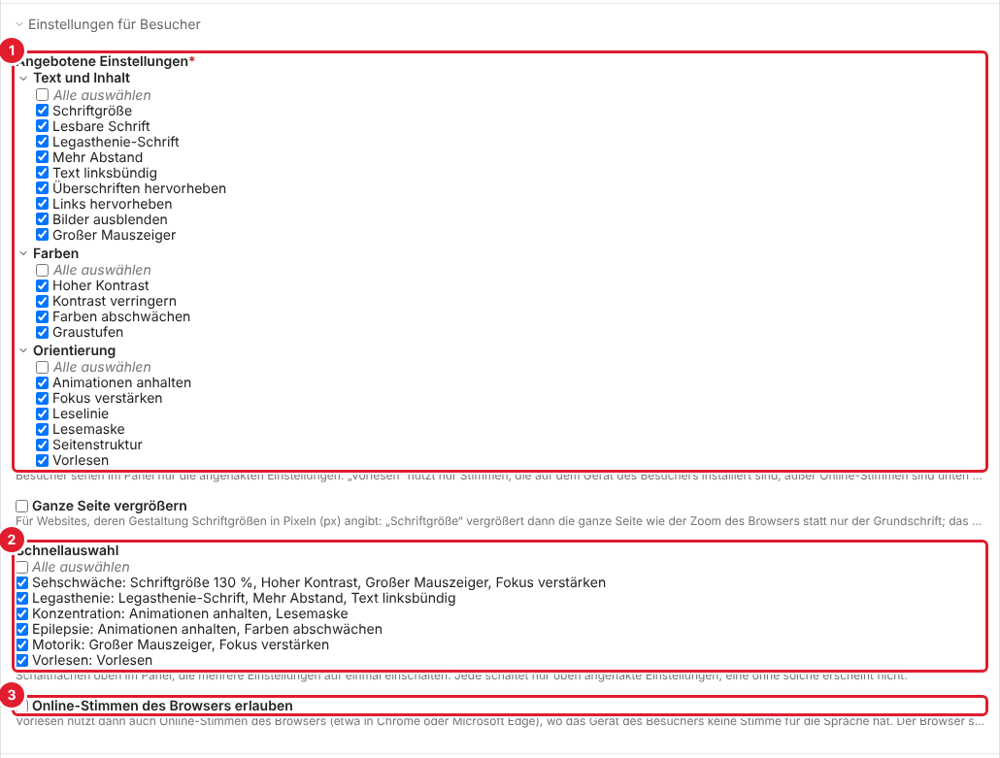

# Einrichtung

## 1. Modul anlegen

1. **Layout › Themes › Frontend-Module › Neues Modul.** Typ: **NEO Digital ›
   Barrierefreiheits-Panel**.
2. Der Kasten oben im Formular (**Lizenz**) nennt die Lizenzbedingung und
   enthält einen Beispieltext für das Impressum (Schritt 4).
3. Die Abschnitte **Einstellungen für Besucher** und **Schaltfläche und
   Panel** ausfüllen (unten) und speichern.

### Angebotene Einstellungen (1)

Bei einem neuen Modul sind alle Einstellungen angehakt; was nicht angeboten
werden soll, abwählen. Mindestens eine bleibt angehakt. Sie sind gruppiert wie
im Panel; **Alle auswählen** hakt eine Gruppe an oder ab.

| Gruppe | Einstellungen |
| --- | --- |
| Text und Inhalt | Schriftgröße, Lesbare Schrift, Legasthenie-Schrift, Mehr Abstand, Text linksbündig, Überschriften hervorheben, Links hervorheben, Bilder ausblenden, Großer Mauszeiger |
| Farben | Hoher Kontrast, Kontrast verringern, Farben abschwächen, Graustufen |
| Orientierung | Animationen anhalten, Fokus verstärken, Leselinie, Lesemaske, Seitenstruktur, Vorlesen |

Was jede für Besucher bewirkt: [Bedienungsanleitung](usage.md).

- **Vorlesen** nutzt die Sprachausgabe des Browsers, standardmäßig nur mit
  Stimmen, die auf dem Gerät des Besuchers installiert sind: Der Text bleibt
  auf dem Gerät. Hat das Gerät keine Stimme für die Sprache der Seite oder
  kann der Browser nicht vorlesen, sehen Besucher die Einstellung ausgegraut
  mit dem Grund ([Bedienungsanleitung](usage.md#vorlesen)). Online-Stimmen
  lassen sich unten erlauben ([Datenschutz](privacy.md)).
- **Legasthenie-Schrift** lädt die Schriftdateien vom eigenen Server, erst
  wenn ein Besucher sie einschaltet.
- **Schriftgröße** vergrößert die Grundschrift der Seite. Das wirkt nur, wo
  die Gestaltung der Website Schriftgrößen in `rem`, `em` oder `%` angibt; mit
  Größen in `px` wächst nur das Panel. Für eine solche Gestaltung **Ganze Seite
  vergrößern** anhaken (unter dem Feld, standardmäßig aus): Die Schriftgröße
  zoomt dann den Inhalt der Seite wie der Zoom des Browsers, das Panel behält
  seine Größe. Das Feld erscheint nur, solange **Schriftgröße** angehakt ist;
  sonst sagt ein Hinweis, warum.
- Eine Einstellung, die später abgewählt wird, gilt für Besucher, die sie
  eingeschaltet hatten, nicht mehr.

### Schnellauswahl (2)

Schaltflächen oben im Panel, die mehrere Einstellungen auf einmal schalten.
Bei einem neuen Modul sind alle sechs angehakt.

| Schnellauswahl | Schaltet ein |
| --- | --- |
| Sehschwäche | Schriftgröße 130 %, Hoher Kontrast, Großer Mauszeiger, Fokus verstärken |
| Legasthenie | Legasthenie-Schrift, Mehr Abstand, Text linksbündig |
| Konzentration | Animationen anhalten, Lesemaske |
| Epilepsie | Animationen anhalten, Farben abschwächen |
| Motorik | Großer Mauszeiger, Fokus verstärken |
| Vorlesen | Vorlesen |

Eine Schnellauswahl schaltet nur Einstellungen, die unter **Angebotene
Einstellungen** angehakt sind. Fehlt eine davon, tritt eine verwandte an ihre
Stelle, wo es eine gibt: Lesbare Schrift für die Legasthenie-Schrift, Leselinie
für die Lesemaske, Graustufen für Farben abschwächen. Alle abwählen, um keine
Schnellauswahl zu zeigen.

Das Feld zeigt immer, was jede Schnellauswahl mit der aktuellen Auswahl
schaltet, etwa „Legasthenie: Lesbare Schrift, Mehr Abstand, Text linksbündig“,
wenn die Legasthenie-Schrift nicht angeboten wird. Eine Änderung unter
**Angebotene Einstellungen** lädt das Formular neu, damit die Liste sofort
folgt. Eine Schnellauswahl, deren Einstellungen alle abgewählt sind, würde
nichts tun: Sie steht nicht im Feld, und ein Hinweis direkt darunter nennt sie
und die Einstellungen, die sie braucht, etwa „Nicht im Panel: Vorlesen
(Vorlesen)“. Ihr Haken bleibt gespeichert; sobald eine ihrer Einstellungen
wieder angehakt ist, steht sie wieder wie vorher da.

### Online-Stimmen des Browsers erlauben (3)

Standardmäßig aus: Vorlesen nutzt nur Stimmen, die auf dem Gerät des Besuchers
installiert sind, und nichts verlässt das Gerät. Angehakt nutzt Vorlesen auch
Online-Stimmen des Browsers (etwa in Chrome oder Microsoft Edge), wo das Gerät
keine Stimme für die Sprache hat; Gerätestimmen haben weiter Vorrang. **Der
Browser schickt den vorgelesenen Text dann an seinen Hersteller, und das muss
in der Datenschutzerklärung stehen** ([Datenschutz](privacy.md)). Solange die
Option an ist, sagt ein Hinweis beim Feld das.

Die Option zählt nur, solange **Vorlesen** unter **Angebotene Einstellungen**
angehakt ist. Sonst erscheint sie nicht, und ein Hinweis an ihrer Stelle sagt
warum; ihr gespeicherter Wert bleibt.

### Schaltfläche und Panel

| Feld | Auswahl | Verhalten |
| --- | --- | --- |
| **Position der Schaltfläche** | unten links (Standard), unten rechts, oben links, oben rechts, keine schwebende Schaltfläche | Ecke der runden Schaltfläche. Schaltflächen anderer Erweiterungen in derselben Ecke werden mit ihr so angeordnet, wie es im Seitenlayout eingestellt ist (siehe unten). Ohne schwebende Schaltfläche öffnet sich das Panel nur über einen Link (Schritt 3). |
| **Wo sich das Panel öffnet** | neben der Schaltfläche (Standard), Leiste links, Leiste rechts, Bildschirmmitte | Neben der Schaltfläche: darüber in den unteren Ecken, darunter in den oberen, ohne schwebende Schaltfläche unten links. Leiste: volle Höhe an einem Bildschirmrand. Bildschirmmitte: in der Mitte. Auf kleinen Bildschirmen scrollt jede Variante in sich. |
| **Hintergrund abdunkeln** | aus (Standard), an | Aus: Das Panel ist ein nicht modaler Dialog; ein Klick daneben schließt es. An: Hinter dem Panel liegt eine abgedunkelte Fläche, das Panel ist ein modaler Dialog, der Rest der Seite ist bis zum Schließen nicht bedienbar; ein Klick auf die Fläche schließt es. |
| **Erklärung zur Barrierefreiheit** | eine Seite | Das Panel verlinkt auf die Seite mit der Erklärung zur Barrierefreiheit. Leer lassen, wenn es keine gibt. Auf einer Website in mehreren Sprachen mit verknüpften Seiten (terminal42/contao-changelanguage, „Hauptsprachseite“) verlinkt das Panel die Erklärung in der Sprache der Seite; dann genügt ein Modul für alle Sprachen. |

### Zusammen mit anderen Schaltflächen in derselben Ecke

Die schwebende Schaltfläche gehört zu den Schaltflächen am Bildschirmrand von
NEO Basic. Sitzen Schaltflächen anderer Erweiterungen in derselben Ecke (der
Knopf des Cookie-Hinweises von NEO Cookie Consent, der Chat von NEO
SuperAgent), werden sie gemeinsam angeordnet, wie es im Seitenlayout unter
**Schaltflächen am Bildschirmrand** eingestellt ist:

| Einstellung im Seitenlayout | Was Besucher sehen |
| --- | --- |
| Eine Einstellungs-Schaltfläche mit Menü (Standard) | Eine runde Einstellungs-Schaltfläche mit Zahnrad in der gemeinsamen Ecke. Ihr Menü bietet **Barrierefreiheit** (das Panel) und die Einträge der anderen Schaltflächen; das Panel öffnet sich über der Einstellungs-Schaltfläche. |
| Übereinander gestapelt | Die Schaltflächen in einer Spalte; das Panel öffnet sich neben seiner Schaltfläche. |
| Nebeneinander | Die Schaltflächen in einer Reihe; das Panel öffnet sich über seiner Schaltfläche. |

Allein in ihrer Ecke bleibt die Schaltfläche, wie sie ist. Der Eintrag
**Cookie-Einstellungen** im Panel erscheint nur, solange die Seite keinen
Knopf des Cookie-Hinweises hat, der dorthin führt.

## 2. Modul ins Seitenlayout einbinden

**Layout › Themes › Seitenlayouts**, das Layout öffnen, **Eingebundene
Module**: das Modul hinzufügen, meist im Bereich **Fußzeile**. Einmal je
Layout einbinden, damit es auf jeder Seite steht; die Position am Bildschirm
kommt aus dem Modul, nicht aus dem Bereich. Für jedes Layout der Website
wiederholen.

Das Modul lässt sich auch mit einem Inhaltselement **Modul** auf einzelnen
Seiten einsetzen; die Auswahl der Besucher gilt dann nur dort.

## 3. Optional: Panel über einen Link öffnen

| Insert-Tag | Ausgabe |
| --- | --- |
| `{{accessibility::link}}` | ein Link mit dem Text „Einstellungen zur Barrierefreiheit“ in der Sprache der Seite |
| `{{accessibility::link::Eigene Beschriftung}}` | derselbe Link mit dem Text „Eigene Beschriftung“ |

Den Insert-Tag in einem Text, einem eigenen HTML-Modul oder in der Fußzeile
einsetzen. Jedes Element mit dem Attribut `data-nax-open` öffnet das Panel
ebenso (auch eigene Schaltflächen). Das Modul muss auf der Seite stehen; ohne
Modul springt der Link nur an den Seitenanfang. Ohne **schwebende
Schaltfläche** ist der Link der einzige Weg zum Panel: ihn auf jeder Seite
einsetzen.

## 4. Hinweis im Impressum ergänzen

Die Erweiterung ist kostenlos mit einem Hinweis im Impressum jeder Website,
auf der sie öffentlich läuft. Der Kasten **Lizenz** oben im Modul enthält den
Text mit Link und das HTML zum Kopieren. Ohne Hinweis nur mit einer
Erlaubnis, die es auf Anfrage gibt (siehe `LICENSE`).

## Prüfen

Eine Seite der Website öffnen: Die runde Schaltfläche erscheint in der
gewählten Ecke (mit anderen Schaltflächen in dieser Ecke: angeordnet, wie im
Seitenlayout eingestellt, z. B. die Einstellungs-Schaltfläche mit ihrem Menü). Das Panel öffnen, eine Einstellung einschalten, die Seite neu
laden: Die Einstellung ist noch an. Erscheint die Schaltfläche nicht:
[Fehlersuche](troubleshooting.md).
