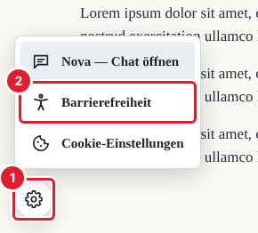
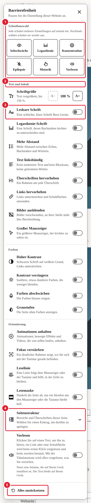
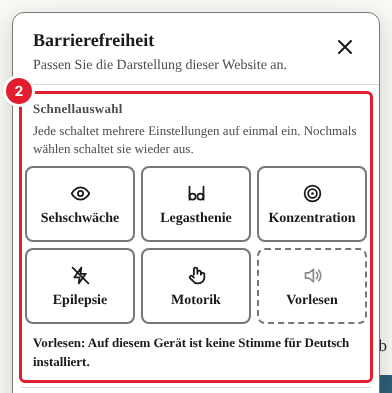
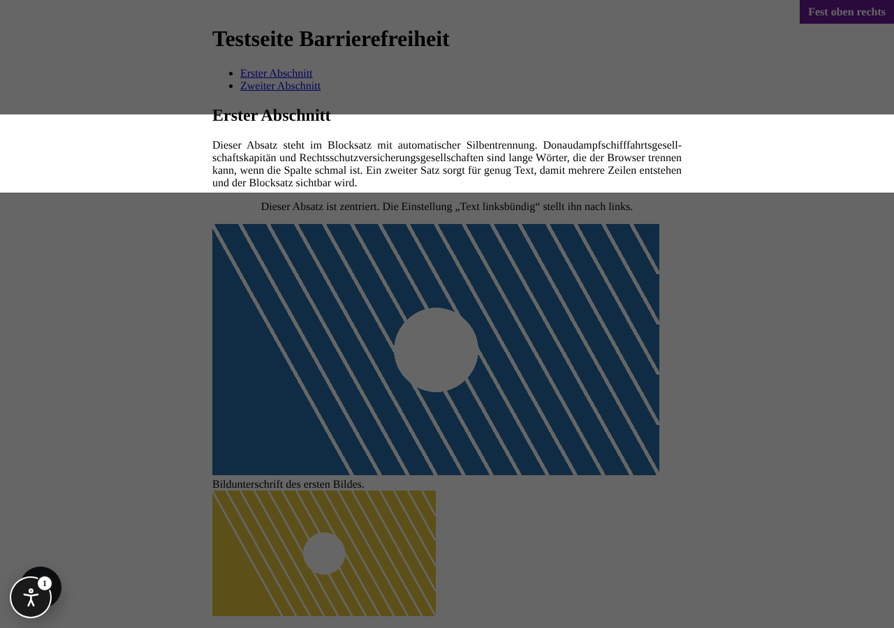
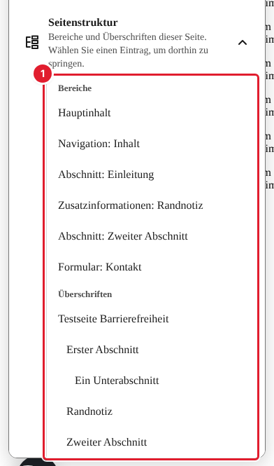
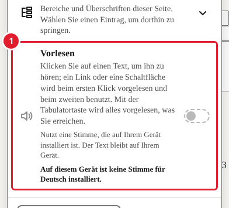
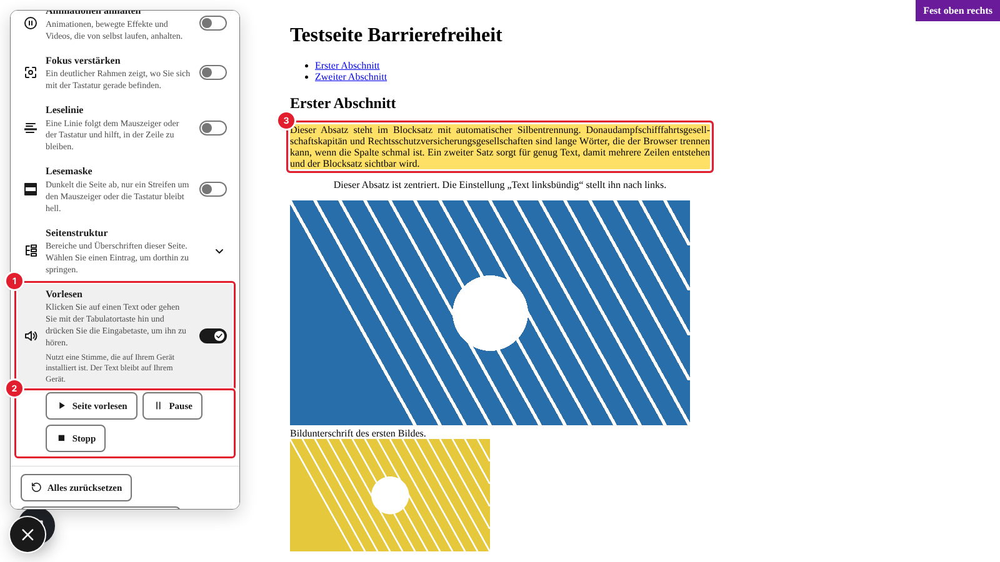
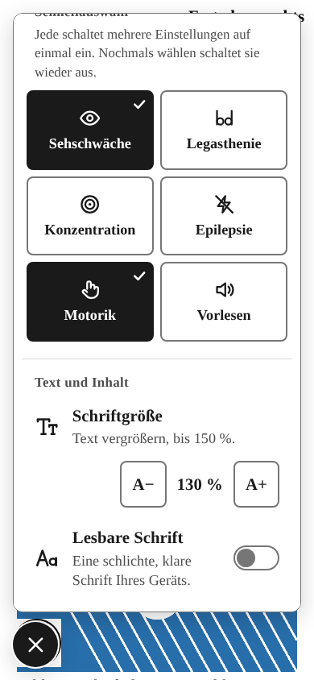

# Bedienungsanleitung

Diese Seite beschreibt das Panel, wie Besucher es nutzen. Sie eignet sich als
Vorlage für Hilfeseiten oder die Erklärung zur Barrierefreiheit der Website.
Welche Einstellungen erscheinen, hängt vom Modul ab ([Einrichtung](setup.md));
hier sind alle beschrieben.

## Panel öffnen und schließen

- **Öffnen:** die runde Schaltfläche in einer Ecke des Bildschirms (oder ein
  Link „Einstellungen zur Barrierefreiheit“ auf der Seite). Mit der Tastatur:
  mit Tab zur Schaltfläche, dann Eingabe- oder Leertaste.
- Der Tastaturfokus springt ins Panel. **Tab** und **Umschalt+Tab** bleiben
  darin, **Esc** schließt es, und der Fokus kehrt zu der Schaltfläche oder dem
  Link zurück, der es geöffnet hat. Ein Klick daneben schließt es ebenfalls
  (mit „Hintergrund abdunkeln“: ein Klick auf die dunkle Fläche).
- **Zähler:** Solange das Panel geschlossen ist, zeigt eine Zahl auf der
  Schaltfläche, wie viele Einstellungen eingeschaltet sind. Vorlesegeräte
  hören sie im Namen der Schaltfläche („Einstellungen zur Barrierefreiheit, 3
  eingeschaltet“).
- Jede Einstellung ist ein Schalter: Klick, Eingabe- oder Leertaste schalten
  sie ein oder aus. Ein ist am Knopf rechts mit Häkchen zu erkennen, nicht nur
  an der Farbe.

## Die Einstellungs-Schaltfläche (mit anderen Schaltflächen in der Ecke)

Teilen sich Schaltflächen anderer Erweiterungen die Ecke der schwebenden
Schaltfläche (der Knopf des Cookie-Hinweises, ein Chat) und ordnet das
Seitenlayout sie als eine Einstellungs-Schaltfläche mit Menü an
([Einrichtung](setup.md#zusammen-mit-anderen-schaltflächen-in-derselben-ecke)),
öffnet sich das Panel aus diesem Menü:

1. Die **Einstellungs-Schaltfläche** mit Zahnrad in der gemeinsamen Ecke.
2. **Barrierefreiheit** öffnet das Panel, über der Einstellungs-Schaltfläche.

- **Mit der Tastatur:** mit Tab zur Schaltfläche. Eingabetaste, Leertaste oder
  Pfeil nach unten öffnet das Menü beim ersten Eintrag, Pfeil nach oben beim
  letzten. Pfeil nach unten und nach oben wandern durch die Einträge (vom
  letzten wieder zum ersten), Pos1 und Ende springen zum ersten und letzten,
  Eingabe- oder Leertaste wählt. **Esc** schließt das Menü, und der Fokus
  kehrt zur Schaltfläche zurück; **Tab** schließt es und geht weiter.
- Schließt sich das Panel, kehrt der Fokus zur Einstellungs-Schaltfläche
  zurück.
- **Zähler:** Eine Zahl neben **Barrierefreiheit** zeigt, wie viele
  Einstellungen des Panels eingeschaltet sind. Vorlesegeräte hören sie als
  Beschreibung des Eintrags („Einstellungen zur Barrierefreiheit, 3
  eingeschaltet“).
- Ein Klick neben das Menü oder nochmals auf die Einstellungs-Schaltfläche
  schließt es.

Übereinander gestapelt oder nebeneinander bleibt die schwebende Schaltfläche,
und das Panel öffnet sich neben ihr.

1. Die **Schnellauswahl** schaltet mehrere Einstellungen auf einmal.
2. Die Einstellungen in drei Gruppen: **Text und Inhalt**, **Farben**,
   **Orientierung**.
3. Eine einzelne Einstellung.
4. **Seitenstruktur** öffnet eine Liste der Bereiche und Überschriften.
5. **Alles zurücksetzen** schaltet alles aus.

## Schnellauswahl

Eine Schnellauswahl schaltet die genannten Einstellungen ein. Sie erscheint
gedrückt (ausgefüllt, mit Häkchen), solange alle davon eingeschaltet sind,
auch wenn sie einzeln eingeschaltet wurden. Nochmals wählen schaltet ihre
Einstellungen wieder aus.

| Schnellauswahl | Schaltet ein | Für |
| --- | --- | --- |
| **Sehschwäche** | Schriftgröße 130 %, Hoher Kontrast, Großer Mauszeiger, Fokus verstärken | Menschen, die schlecht sehen |
| **Legasthenie** | Legasthenie-Schrift, Mehr Abstand, Text linksbündig | Menschen mit Legasthenie oder Leseschwierigkeiten |
| **Konzentration** | Animationen anhalten, Lesemaske | Menschen, die sich leicht ablenken lassen (etwa mit ADHS) |
| **Epilepsie** | Animationen anhalten, Farben abschwächen | Menschen, die empfindlich auf Bewegung, Flackern und kräftige Farben reagieren |
| **Motorik** | Großer Mauszeiger, Fokus verstärken | Menschen, die die Maus schwer oder nur die Tastatur nutzen |
| **Vorlesen** | Vorlesen | Menschen, die lieber zuhören |

Bietet die Website eine dieser Einstellungen nicht an, lässt die
Schnellauswahl sie weg oder nimmt eine verwandte (Lesbare Schrift für die
Legasthenie-Schrift, Leselinie für die Lesemaske, Graustufen für Farben
abschwächen). Die Schnellauswahl **Vorlesen** ist ausgegraut, mit dem Grund
unter der Schnellauswahl, wo Vorlesen nicht geht (siehe [Vorlesen](#vorlesen)).

## Text und Inhalt

| Einstellung | Was sie bewirkt |
| --- | --- |
| **Schriftgröße** | A− und A+ ändern die Schriftgröße in Stufen: 100 %, 115 %, 130 %, 150 %. Alles, was die Website im Verhältnis zur Schrift bemisst, wächst mit; mit der Moduloption **Ganze Seite vergrößern** wächst die ganze Seite, wie beim Zoom des Browsers. |
| **Lesbare Schrift** | Zeigt allen Text in einer schlichten, klaren Schrift des Geräts (Verdana oder eine ähnliche). Nichts wird heruntergeladen. Symbole behalten ihre eigene Schrift. |
| **Legasthenie-Schrift** | Zeigt allen Text in OpenDyslexic, einer Schrift, deren Buchstaben unten schwerer sind und sich leichter unterscheiden lassen. Die Schrift kommt beim Einschalten vom Server der Website. Schaltet **Lesbare Schrift** aus. |
| **Mehr Abstand** | Zeilenhöhe 1,5-fach, mehr Abstand zwischen Buchstaben (0,12-fach) und Wörtern (0,16-fach) und nach Absätzen (doppelte Schriftgröße) — die Werte aus WCAG 1.4.12. |
| **Text linksbündig** | Zentrierter Text und Blocksatz stehen linksbündig, Wörter werden am Zeilenende nicht mehr getrennt. Schaltflächen und Formularfelder behalten ihre Ausrichtung. |
| **Überschriften hervorheben** | Ein Rahmen um jede Überschrift, damit der Aufbau der Seite gut zu sehen ist. |
| **Links hervorheben** | Unterstreicht jeden Link und umrandet jede Schaltfläche. |
| **Bilder ausblenden** | Bilder verschwinden. Hat ein Bild eine Beschreibung (Alternativtext), steht sie an seiner Stelle, etwa „Bild: Blaue Fläche mit weißen Streifen“. Schmuckbilder ohne Beschreibung hinterlassen nichts. Hintergrundbilder des Designs bleiben, weil oft Text darauf steht. |
| **Großer Mauszeiger** | Ein großer weißer Mauszeiger mit schwarzem Rand und eine große Hand über Links und Schaltflächen. |

## Farben

Die Farbeinstellungen ändern die ganze Seite, nicht das Panel; das Panel
bleibt lesbar. Am Bildschirm fest stehende Elemente (ein Kopfbereich, eine
Chat-Schaltfläche) bleiben, wo sie sind.

| Einstellung | Was sie bewirkt |
| --- | --- |
| **Hoher Kontrast** | Schwarze Schrift auf weißem Grund, Links dunkelblau und unterstrichen, schwarze Rahmen, Schaltflächen und Felder mit sichtbarem Rand, keine Hintergrundbilder. Schaltet **Kontrast verringern** aus. |
| **Kontrast verringern** | Sanftere, etwas dunklere Farben: Weiß wird hellgrau, Schwarz dunkelgrau. Weniger Blendung für lichtempfindliche Menschen; der Text bleibt gut lesbar. Schaltet **Hoher Kontrast** aus. |
| **Farben abschwächen** | Zeigt alle Farben blasser. |
| **Graustufen** | Zeigt die Seite ohne Farben. |

## Orientierung

| Einstellung | Was sie bewirkt |
| --- | --- |
| **Animationen anhalten** | Beendet Animationen und Übergänge sofort, schaltet weiches Scrollen ab und hält Videos an, die von selbst laufen. Ein Video, das der Besucher startet, läuft wie gewohnt. Bewegte Effekte, die die Website mit eigenen Zeitgebern steuert (manche Bildwechsler), können weiterlaufen. |
| **Fokus verstärken** | Ein dicker dunkler Rahmen mit hellem Saum um das Element mit dem Tastaturfokus, sichtbar auf hellem und dunklem Grund. |
| **Leselinie** | Eine dunkle Linie unter dem Mauszeiger folgt ihm über die Seite. Mit der Tastatur liegt sie unter dem Element mit dem Fokus. Schaltet **Lesemaske** aus. |
| **Lesemaske** | Dunkelt die Seite ab, nur ein Streifen um den Mauszeiger oder das Element mit dem Fokus bleibt hell, sodass nur wenige Zeilen hell sind. Schaltet **Leselinie** aus. |
| **Seitenstruktur** | Siehe unten. |
| **Vorlesen** | Siehe unten. |

### Seitenstruktur

**Seitenstruktur** öffnet darunter eine Liste, erstellt aus der Seite, wie sie
gerade ist:

- **Bereiche:** Kopfbereich, Navigation, Hauptinhalt, Zusatzinformationen,
  Fußbereich, Suche und benannte Formulare und Abschnitte, jeweils mit ihrem
  Namen, wo die Website einen vergibt (etwa „Navigation: Inhalt“).
- **Überschriften:** jede Überschrift der Seite, eingerückt nach ihrer Ebene.

Ein Eintrag schließt das Panel, scrollt die Seite dorthin und setzt den
Tastaturfokus darauf; das nächste Tab geht von dort weiter. Nochmals
**Seitenstruktur** wählen schließt die Liste.

### Vorlesen

**Vorlesen** liest Texte der Seite mit einer Stimme des Browsers vor.

1. **Vorlesen** einschalten.
2. Auf einen Absatz, eine Überschrift, einen Listenpunkt oder eine
   Tabellenzelle klicken: Er wird vorgelesen und gelb markiert, solange er
   gelesen wird.
3. Auf einen Link, eine Schaltfläche, die Frage eines Akkordeons, die
   Beschriftung eines Häkchens oder eine Karte klicken, die eine Seite öffnet:
   Der Text unter dem Zeiger wird vorgelesen (oder der Name des
   Bedienelements), und der Klick bewirkt sonst nichts. Ein dunkler Hinweis
   daneben sagt „Zum Benutzen noch einmal klicken oder tippen.“, und
   Vorlesegeräte sagen ihn an; der nächste Klick auf dasselbe Bedienelement
   benutzt es wie gewohnt. Ein Klick woanders, Scrollen, der nächste Fokus mit
   der Tastatur oder **Esc** nehmen den Hinweis zurück. Ein Klick in ein
   Eingabefeld liest seine Beschriftung vor und wirkt sofort.
4. Mit der Tastatur: Die Texte des Hauptinhalts sind jetzt mit Tab
   erreichbar. Alles, was den Fokus bekommt, wird vorgelesen: Texte, Links,
   Schaltflächen und die Beschriftungen von Feldern. Eingabe- oder Leertaste
   benutzen einen Link oder eine Schaltfläche sofort, wie immer, und lesen
   einen Text noch einmal vor.
5. **Seite vorlesen** liest den Hauptinhalt von Anfang an vor, Text für Text;
   die Seite scrollt mit.
6. **Pause** hält kurz an, **Weiter** setzt fort, **Stopp** beendet das
   Vorlesen. Bei geschlossenem Panel beendet auch **Esc** das Vorlesen.

Klicks über die Tastatur und aus Skripten der Website werden nie
zurückgehalten, ebenso wenig die Bedienelemente des Panels und die Wege, es zu
öffnen.

Die Stimme passt zur Sprache der Seite (oder des Seitenteils, wenn er als
andere Sprache ausgezeichnet ist). Standardmäßig lesen nur Stimmen, die auf dem
Gerät des Besuchers installiert sind; der Text bleibt so auf dem Gerät, und der
Hinweis unter dem Schalter sagt das. Kurz nach dem Laden der Seite brauchen
manche Browser einen Moment, bis sie ihre Stimmen melden: Ein Text, der in
diesem Moment angeklickt wird, wird gelesen, sobald sie bekannt sind.

**Wenn Vorlesen nicht geht.** Hat das Gerät keine Stimme für die Sprache der
Seite, oder kann der Browser gar nicht vorlesen, sind **Vorlesen** und die
Schnellauswahl **Vorlesen** ausgegraut und lassen sich nicht einschalten.
Daneben steht der Grund, etwa „Auf diesem Gerät ist keine Stimme für Deutsch
installiert.“ Wer in den Spracheinstellungen des Geräts eine Stimme für die
Sprache installiert (Windows, macOS, Android und andere bieten Stimmen zum
Herunterladen an), kann danach vorlesen lassen; eine früher eingeschaltete
Einstellung kommt von selbst wieder.

Erlaubt die Website die Online-Stimmen des Browsers, liest eine Online-Stimme,
wo das Gerät keine hat, und der Hinweis unter dem Schalter sagt, dass manche
Browser den Text dann an einen Online-Dienst ihres Herstellers schicken
([Datenschutz](privacy.md)).

1. Der Schalter **Vorlesen** mit dem Hinweis auf die Stimmen.
2. **Seite vorlesen**, **Pause**, **Stopp**.
3. Der Text, der gerade vorgelesen wird, markiert.

## Alles zurücksetzen und was sich das Panel merkt

- **Alles zurücksetzen** unten im Panel schaltet jede Einstellung aus.
- Die Auswahl gilt auf jeder Seite der Website und bleibt, bis der Besucher
  sie zurücksetzt oder die Browserdaten löscht. Sie liegt nur im Browser des
  Besuchers, und erst, wenn er etwas ändert.
- Im privaten Fenster oder wenn der Browser das Speichern sperrt, gilt die
  Auswahl nur für die aktuelle Seite.

## Am Handy

Das Panel füllt die Breite des Bildschirms und scrollt in sich. Jede
Schaltfläche ist mindestens 44 × 44 Pixel groß. Die Schnellauswahl steht je
nach Breite in zwei oder drei Spalten.

## Weitere Links im Panel

- **Erklärung zur Barrierefreiheit:** öffnet die Erklärung der Website, wenn
  es eine gibt.
- **Cookie-Einstellungen:** erscheint nur, wenn das Cookie-Werkzeug der
  Website es unterstützt, und öffnet dessen Einstellungen. Der Eintrag
  entfällt, solange der Knopf des Cookie-Hinweises (allein oder im Menü der
  Einstellungs-Schaltfläche) dorthin führt.
