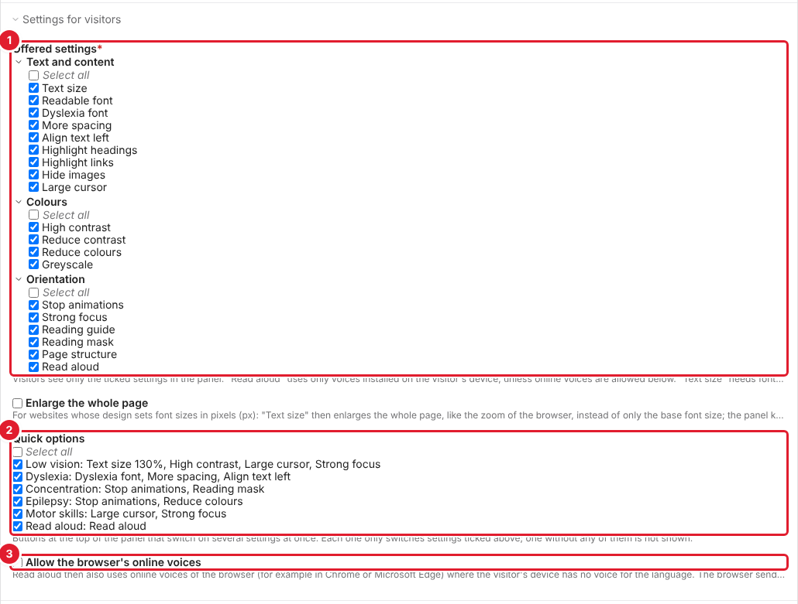

# Setup

## 1. Create the module

1. **Layout › Themes › Front-end modules › New module.** Type: **NEO Digital ›
   Accessibility panel**.
2. The box at the top of the form (**Licence**) describes the licence
   condition and has an example text for the legal notice (step 4).
3. Fill in the sections **Settings for visitors** and **Button and panel**
   (below) and save.

### Offered settings (1)

All settings are ticked for a new module; untick what you do not want to
offer. At least one stays ticked. They are grouped as in the panel; **Select
all** ticks or unticks a group.

| Group | Settings |
| --- | --- |
| Text and content | Text size, Readable font, Dyslexia font, More spacing, Align text left, Highlight headings, Highlight links, Hide images, Large cursor |
| Colours | High contrast, Reduce contrast, Reduce colours, Greyscale |
| Orientation | Stop animations, Strong focus, Reading guide, Reading mask, Page structure, Read aloud |

What each one does for visitors: [User manual](usage.md).

- **Read aloud** uses the speech output of the visitor's browser, by default
  only with voices installed on the visitor's device: the text stays on the
  device. Where the device has no voice for the page language, or the browser
  cannot speak, visitors see the option greyed out with the reason
  ([User manual](usage.md#read-aloud)). Online voices can be allowed below
  ([Privacy](privacy.md)).
- **Dyslexia font** loads the font files from your own server, only when a
  visitor switches it on.
- **Text size** scales the base font size of the page. It only has an effect
  where the design of the website sets font sizes in `rem`, `em` or `%`; with
  sizes in `px` only the panel grows. For such a design tick **Enlarge the
  whole page** (below the field, off by default): the text size then zooms the
  content of the page like the zoom of the browser, the panel keeps its size.
  The field only appears while **Text size** is ticked; otherwise a note says
  why.
- A setting you untick later is no longer applied for visitors who had
  switched it on.

### Quick options (2)

Buttons at the top of the panel that switch several settings at once. All six
are ticked for a new module.

| Quick option | Switches on |
| --- | --- |
| Low vision | Text size 130 %, High contrast, Large cursor, Strong focus |
| Dyslexia | Dyslexia font, More spacing, Align text left |
| Concentration | Stop animations, Reading mask |
| Epilepsy | Stop animations, Reduce colours |
| Motor skills | Large cursor, Strong focus |
| Read aloud | Read aloud |

A quick option only switches settings that are ticked under **Offered
settings**. If one of them is not offered, a related one takes its place
where there is one: Readable font for the Dyslexia font, Reading guide for
the Reading mask, Greyscale for Reduce colours. Untick all to show no quick
options.

The field always shows what each quick option switches with the current
choice, for example "Dyslexia: Readable font, More spacing, Align text left"
when the Dyslexia font is not offered. Changing **Offered settings** reloads
the form, so the list follows at once. A quick option whose settings are all
unticked would do nothing: it is not offered in the field, and a note directly
below it names it and the settings it needs, for example "Not in the panel:
Read aloud (Read aloud)". Its ticked state is kept; once one of its settings
is ticked again, it is back as it was.

### Allow the browser's online voices (3)

Off by default: read aloud uses only voices installed on the visitor's device,
and nothing leaves the device. When ticked, read aloud also uses online voices
of the browser (for example in Chrome or Microsoft Edge) where the device has
no voice for the language; device voices still come first. **The browser then
sends the text being read to its maker, and the privacy policy must say so**
([Privacy](privacy.md)). While the option is on, a note at the field says this.

The option only matters while **Read aloud** is ticked under **Offered
settings**. Otherwise it is not shown, and a note in its place says why; its
stored value stays.

### Button and panel

| Field | Options | Behaviour |
| --- | --- | --- |
| **Position of the button** | bottom left (default), bottom right, top left, top right, no floating button | Corner of the round button. Buttons of other extensions in the same corner are arranged with it as set in the page layout (see below). Without a floating button the panel only opens from a link (step 3). |
| **Where the panel opens** | next to the button (default), drawer on the left, drawer on the right, centre of the screen | Next to the button: above it in the bottom corners, below it in the top corners, in the bottom left corner without a floating button. Drawer: full height at an edge of the screen. Centre: in the middle. On small screens every layout scrolls inside. |
| **Darken the background** | off (default), on | Off: the panel is a non-modal dialog; a click outside closes it. On: a dimmed layer lies behind the panel, the panel is a modal dialog, the rest of the page cannot be used until it closes; a click on the layer closes it. |
| **Accessibility statement** | a page | The panel links to the page with your accessibility statement. Leave it empty if there is none. On a website in several languages with linked pages (terminal42/contao-changelanguage, "Main language page"), the panel links the statement in the language of the page, so one module serves every language. |

### Together with other buttons in the same corner

The floating button takes part in the buttons at the edge of the screen of
NEO Basic. When buttons of other extensions sit in the same corner (the button
of the cookie banner of NEO Cookie Consent, the chat of NEO SuperAgent), they
are arranged together as set in the page layout under **Buttons at the edge
of the screen**:

| Setting of the page layout | What visitors see |
| --- | --- |
| One settings button with a menu (default) | One round settings button with a cogwheel in the shared corner. Its menu offers **Accessibility** (the panel) and the entries of the other buttons; the panel opens above the settings button. |
| Stacked one above the other | The buttons in a column; the panel opens next to its button. |
| Side by side | The buttons in a row; the panel opens above its button. |

Alone in its corner the button stays as it is. The entry **Cookie settings**
in the panel is shown only while the page has no button of the cookie banner
that leads there.

## 2. Add the module to the page layout

**Layout › Themes › Page layouts**, open the layout, **Included modules**:
add the module, usually in the **footer** section. Place it once per layout so
it is on every page; the position on the screen comes from the module, not
from the section. Repeat for every layout of the website.

The module can also be placed with a **Module** content element on single
pages; the visitor's choices then apply on those pages only.

## 3. Optional: open the panel from a link

| Insert tag | Output |
| --- | --- |
| `{{accessibility::link}}` | a link with the text "Accessibility settings" in the language of the page |
| `{{accessibility::link::Own label}}` | the same link with the text "Own label" |

Use the insert tag in a text, a custom HTML module or the footer. Any element
with the attribute `data-nax-open` opens the panel as well (your own buttons
too). The module must be on the page; without it the link only jumps to the
top of the page. With **no floating button**, the link is the only way to the
panel: place it on every page.

## 4. Add the credit to the legal notice

The extension is free with a credit in the legal notice of every website on
which it runs publicly. The box **Licence** at the top of the module form has
the text with link and the HTML to copy. Leaving out the credit needs a
permission, given on request (see `LICENSE`).

## Check

Open a page of the website: the round button appears in the chosen corner
(with other buttons in that corner: arranged as set in the page layout, e.g.
the settings button with its menu).
Open the panel, switch a setting on, reload the page: the setting is still
on. If the button does not appear: [Troubleshooting](troubleshooting.md).
