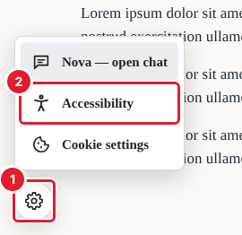
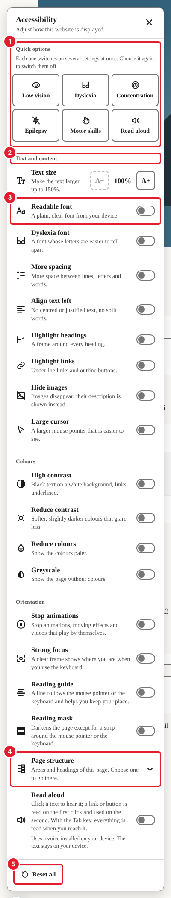
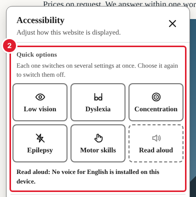
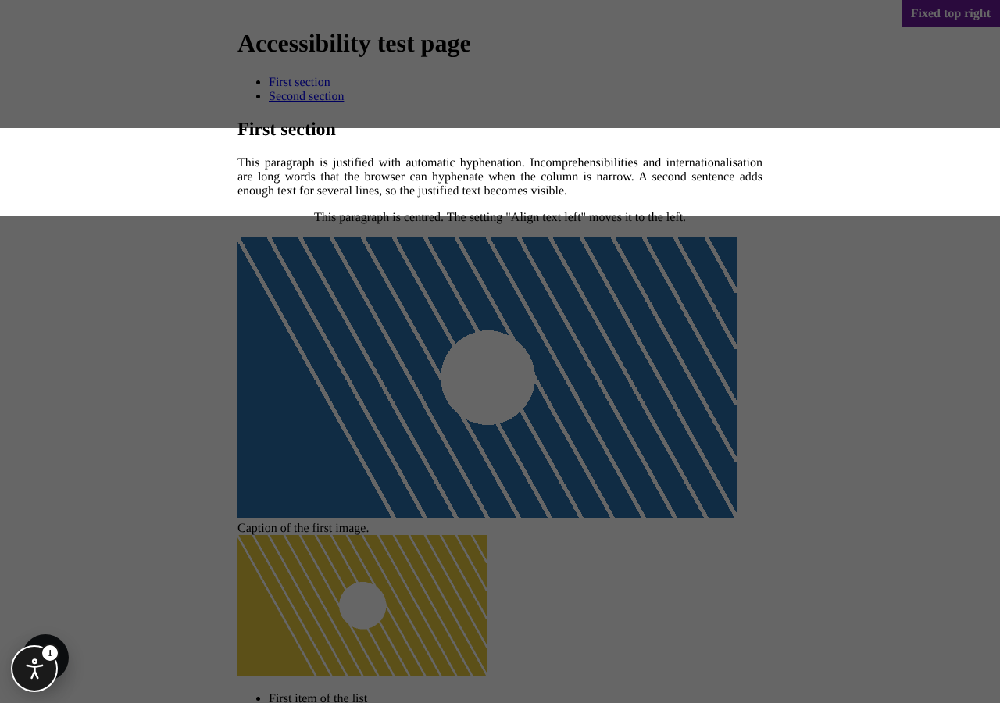
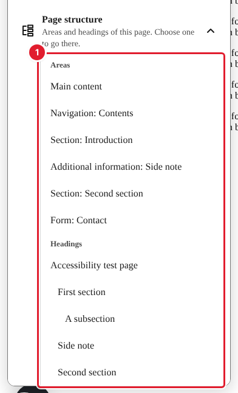
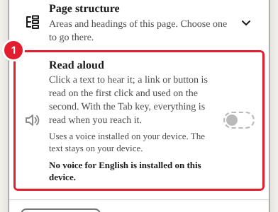
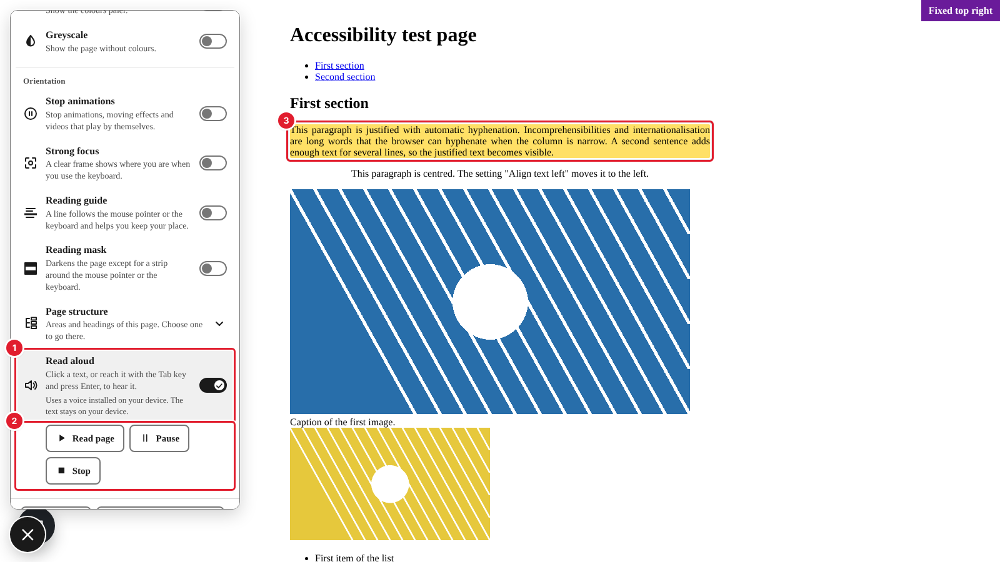
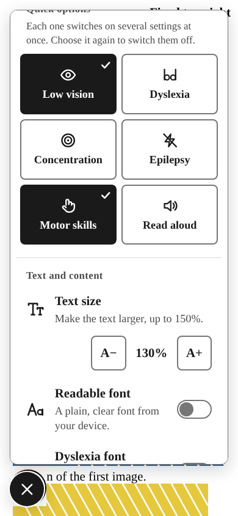

# User manual

This page describes the panel as visitors use it. Use it for the help pages
or the accessibility statement of the website. Which settings appear depends
on the module ([Setup](setup.md)); this page describes all of them.

## Opening and closing the panel

- **Open:** the round button in a corner of the screen (or a link "Accessibility
  settings" on the page). With the keyboard: Tab to the button, Enter or
  Space.
- The keyboard focus moves into the panel. **Tab** and **Shift+Tab** stay
  inside it, **Esc** closes it, and the focus goes back to the button or link
  that opened it. A click outside closes it too (with "Darken the background":
  a click on the dark layer).
- **Counter:** while the panel is closed, a number on the button shows how
  many settings are on. Screen readers hear it in the button's name
  ("Accessibility settings, 3 switched on").
- Every setting is a switch: a click, Enter or Space switches it on or off.
  On is shown by the knob on the right with a tick, not by colour alone.

## The settings button (with other buttons in the corner)

When buttons of other extensions share the corner of the floating button (the
button of the cookie banner, a chat) and the page layout arranges them as one
settings button with a menu ([Setup](setup.md#together-with-other-buttons-in-the-same-corner)),
the panel opens from that menu:

1. The **settings button** with a cogwheel in the shared corner.
2. **Accessibility** opens the panel, above the settings button.

- **With the keyboard:** Tab to the button. Enter, Space or Arrow down opens
  the menu on its first entry, Arrow up on its last. Arrow down and Arrow up
  move through the entries (from the last back to the first), Home and End go
  to the first and the last, Enter or Space chooses. **Esc** closes the menu
  and the focus goes back to the button; **Tab** closes it and moves on.
- When the panel closes, the focus goes back to the settings button.
- **Counter:** a number next to **Accessibility** shows how many settings of
  the panel are on. Screen readers hear it as the description of the entry
  ("Accessibility settings, 3 switched on").
- A click outside the menu or on the settings button again closes it.

Stacked one above the other or side by side, the floating button stays and
the panel opens next to it.

1. **Quick options** switch several settings at once.
2. The settings in three groups: **Text and content**, **Colours**,
   **Orientation**.
3. A single setting.
4. **Page structure** opens a list of the page's areas and headings.
5. **Reset all** switches everything off.

## Quick options

A quick option switches on the settings listed. It is shown as pressed (filled,
with a tick) while all of them are on, also if they were switched on one by
one. Choosing it again switches its settings off again.

| Quick option | Switches on | For |
| --- | --- | --- |
| **Low vision** | Text size 130 %, High contrast, Large cursor, Strong focus | People who see poorly |
| **Dyslexia** | Dyslexia font, More spacing, Align text left | People with dyslexia or reading difficulties |
| **Concentration** | Stop animations, Reading mask | People who are easily distracted (for example with ADHD) |
| **Epilepsy** | Stop animations, Reduce colours | People sensitive to movement, flashing and strong colours |
| **Motor skills** | Large cursor, Strong focus | People who use the mouse with difficulty or only the keyboard |
| **Read aloud** | Read aloud | People who prefer to listen |

If the website does not offer one of these settings, the quick option leaves
it out or uses a related one (Readable font for the Dyslexia font, Reading
guide for the Reading mask, Greyscale for Reduce colours). The quick option
**Read aloud** is greyed out, with the reason below the quick options, where
read aloud cannot be used (see [Read aloud](#read-aloud)).

## Text and content

| Setting | What it does |
| --- | --- |
| **Text size** | A− and A+ change the text size in steps: 100 %, 115 %, 130 %, 150 %. Everything the website sizes in relation to the text grows with it; with the module option **Enlarge the whole page** the whole page grows, like with the zoom of the browser. |
| **Readable font** | Shows all text in a plain, clear font of the device (Verdana or a similar one). Nothing is downloaded. Icons keep their own font. |
| **Dyslexia font** | Shows all text in OpenDyslexic, a font whose letters have a heavier lower part and are easier to tell apart. The font comes from the website's server when the setting is switched on. Switches **Readable font** off. |
| **More spacing** | Line height 1.5 times the text size, more space between letters (0.12 times) and words (0.16 times) and after paragraphs (twice the text size) — the values of WCAG 1.4.12. |
| **Align text left** | Centred and justified text is aligned to the left, words are no longer split at the end of a line. Buttons and form fields keep their alignment. |
| **Highlight headings** | A frame around every heading, so the structure of the page is easy to see. |
| **Highlight links** | Underlines every link and outlines every button. |
| **Hide images** | Pictures disappear. Where an image has a description (alt text), the description is shown in its place, for example "Image: Blue area with white stripes". Decorative images without a description leave nothing. Background pictures of the design stay, because text often sits on them. |
| **Large cursor** | A large white mouse pointer with a black edge, and a large hand over links and buttons. |

## Colours

The colour settings change the whole page, not the panel; the panel stays
readable. Elements fixed on the screen (a header, a chat button) stay where
they are.

| Setting | What it does |
| --- | --- |
| **High contrast** | Black text on a white background, links dark blue and underlined, black borders, buttons and fields with a visible edge, no background pictures. Switches **Reduce contrast** off. |
| **Reduce contrast** | Softer and slightly darker colours: white becomes light grey, black dark grey. Less glare for people sensitive to light; text stays clearly readable. Switches **High contrast** off. |
| **Reduce colours** | Shows all colours paler. |
| **Greyscale** | Shows the page without colours. |

## Orientation

| Setting | What it does |
| --- | --- |
| **Stop animations** | Ends animations and transitions at once, stops smooth scrolling and pauses videos that play by themselves. A video the visitor starts plays as usual. Moving effects that the website drives with its own timers (some slide shows) may keep moving. |
| **Strong focus** | A thick dark frame with a light edge around the element that has the keyboard focus, visible on light and dark backgrounds. |
| **Reading guide** | A dark line under the mouse pointer follows it across the page. With the keyboard it sits under the element that has the focus. Switches **Reading mask** off. |
| **Reading mask** | Darkens the page except for a strip around the mouse pointer or the focused element, so only a few lines are bright. Switches **Reading guide** off. |
| **Page structure** | See below. |
| **Read aloud** | See below. |

### Page structure

**Page structure** opens a list below it, made from the page as it is at that
moment:

- **Areas:** header, navigation, main content, additional information, footer,
  search and named forms and sections, each with its name where the website
  gives one (for example "Navigation: Contents").
- **Headings:** every heading of the page, indented by its level.

Choosing an entry closes the panel, scrolls the page there and moves the
keyboard focus to it, so the next Tab continues from there. Choosing **Page
structure** again closes the list.

### Read aloud

**Read aloud** reads texts of the page with a voice of the browser.

1. Switch on **Read aloud**.
2. Click a paragraph, heading, list item or table cell: it is read aloud and
   marked yellow while it is read.
3. Click a link, a button, the question of an accordion, the label of a
   checkbox or a card that opens a page: the text under the pointer is read
   (or the name of the control) and the click does nothing else. A dark hint
   next to it says "Click or tap again to use it", and screen readers
   announce it; the next click on the same control uses it as usual. A click
   elsewhere, scrolling, the next focus with the keyboard or **Esc** take the
   hint back. Clicking into a field for typing reads its label and works at
   once.
4. With the keyboard: the texts of the main content can now be reached with
   Tab. Everything that gets the focus is read: texts, links, buttons and the
   labels of fields. Enter or Space use a link or button at once, as always,
   and read a text again.
5. **Read page** reads the main content from the beginning, text by text; the
   page scrolls along.
6. **Pause** stops for a moment, **Continue** goes on, **Stop** ends reading.
   With the panel closed, **Esc** also ends reading.

Clicks from the keyboard and from scripts of the website are never held back,
nor are the controls of the panel and the ways to open it.

The voice matches the language of the page (or of the part of the page, if it
is marked as another language). By default only voices installed on the
visitor's device read, so the text stays on the device; the note under the
switch says so. Right after the page has loaded, some browsers need a moment to
report their voices: a text clicked in that moment is read as soon as they are
known.

**When read aloud cannot be used.** If the device has no voice for the
language of the page, or the browser cannot speak at all, **Read aloud** and
the quick option **Read aloud** are greyed out and cannot be switched on. The
reason stands next to them, for example "No voice for German is installed on
this device." Installing a voice for the language in the speech settings of the
device (Windows, macOS, Android and others offer voices to download) makes it
available; a setting switched on earlier comes back by itself.

If the website allows the browser's online voices, an online voice reads where
the device has none, and the note under the switch says that some browsers
then send the text to an online service of their maker ([Privacy](privacy.md)).

1. The switch **Read aloud** with the note on the voices.
2. **Read page**, **Pause**, **Stop**.
3. The text being read, marked.

## Reset all and what the panel remembers

- **Reset all** at the bottom of the panel switches every setting off.
- The choice applies on every page of the website and stays until the visitor
  resets it or clears the browser data. It is stored in the visitor's browser
  only, and only once the visitor changes something.
- In a private window, or when the browser blocks storage, the choice lasts
  for the current page only.

## On a phone

The panel fills the width of the screen and scrolls inside. Every button is
at least 44 × 44 pixels. Quick options stand in two or three columns,
depending on the width.

## Further links in the panel

- **Accessibility statement:** opens the website's statement, if the website
  has one.
- **Cookie settings:** appears only if the website's cookie tool supports it,
  and opens its settings. It is left out while the button of the cookie
  banner (on its own or in the menu of the settings button) leads there.
